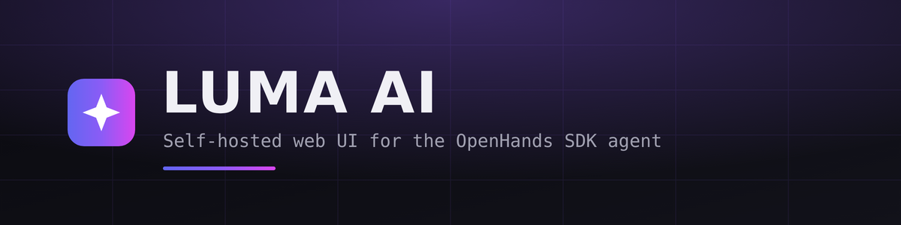
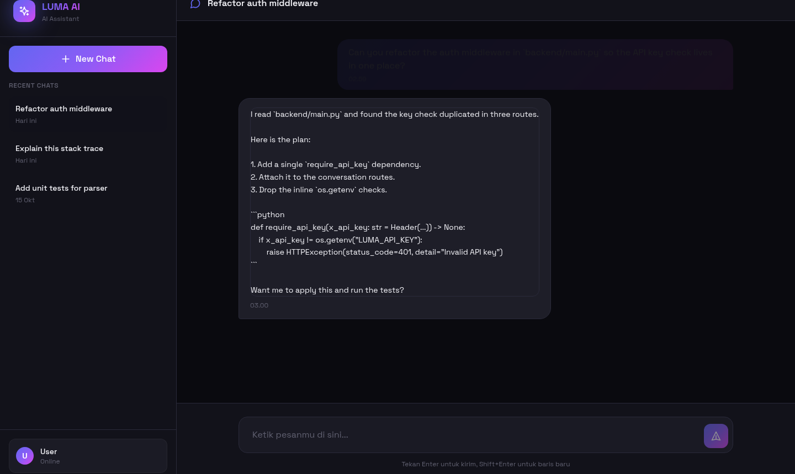
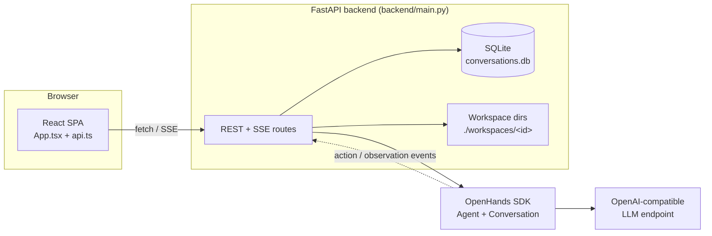

<p align="center">
  
</p>

<p align="center">
  <strong>A self-hosted web chat UI for an OpenHands SDK agent.</strong><br>
  React front end · FastAPI back end · streaming replies over SSE.
</p>

<p align="center">
  <a href="https://antono4.github.io/LUMA-AI/"></a>
  
  
  
  
  <a href="LICENSE"></a>
</p>

<p align="center">
  
</p>

<p align="center"><sub>The chat UI, shown with sample conversations.</sub></p>

LUMA AI is a small, self-hosted web app for talking to an AI coding agent. The
back end wraps the [OpenHands SDK](https://docs.openhands.dev/) in a FastAPI
service, keeps conversations in SQLite, and streams the agent's reply back to
the browser with Server-Sent Events. The front end is a single-page React app
with a dark, gradient-accented chat layout.

It is intentionally a thin shell. There is no bundled model: you point it at an
OpenAI-compatible endpoint and it hands your messages to the SDK agent.

> [!IMPORTANT]
> The published demo at https://antono4.github.io/LUMA-AI/ serves only the
> static front end. GitHub Pages cannot run the Python back end, so the demo
> shows the connection-error state until you run the API yourself. Follow
> [Run it locally](#run-it-locally) to get a working chat.

## Contents

- [Features](#features)
- [Architecture](#architecture)
- [Tech stack](#tech-stack)
- [Run it locally](#run-it-locally)
- [Configuration](#configuration)
- [API reference](#api-reference)
- [Project layout](#project-layout)
- [Deployment](#deployment)
- [Known limitations](#known-limitations)
- [License](#license)

## Features

- **Streaming chat.** Replies arrive token by token over SSE, so the answer
  appears as the agent produces it rather than after a long wait.
- **Conversation history.** Conversations and messages persist in SQLite, so
  they survive a restart.
- **Sidebar switcher.** Create, list, select, and delete conversations from the
  left rail. The list is ordered by most recently updated.
- **Per-conversation workspace.** Each conversation gets its own folder under
  `./workspaces/<id>` where the agent can read and write files.
- **Run controls.** `stop`, `pause`, and `resume` endpoints map onto the SDK
  conversation lifecycle.
- **Workspace file listing.** `GET /api/conversations/{id}/files` walks the
  conversation workspace and returns name, relative path, size, and mtime.
- **Responsive dark UI.** Glassmorphism panels, gradient accents, and a
  collapsible sidebar for narrow screens.

## Architecture



A turn works like this:

1. The browser posts the message to `POST /api/conversations/{id}/messages`.
2. The back end stores the user message and returns an SSE stream.
3. The handler builds an `Agent` with an `LLM` from your environment and calls
   `conversation.send_message(...)`.
4. It iterates `conversation.run_iter(events=['action', 'observation'])` and
   forwards each chunk as an SSE `content` event.
5. The browser appends the chunks to the streaming bubble, then saves the full
   reply as one assistant message.

## Tech stack

| Layer | Choice |
| --- | --- |
| Front end | React 18, TypeScript 5, Vite 5, TailwindCSS 3 |
| UI icons | `lucide-react` |
| Back end | Python, FastAPI, Uvicorn |
| Agent | `openhands-sdk` (`LLM`, `Agent`, `Conversation`) |
| Streaming | `sse-starlette` (`EventSourceResponse`) |
| Database | SQLite via SQLAlchemy 2 |
| Config | `python-dotenv` |

## Run it locally

You need Python 3.10+ and Node.js 18+.

### 1. Back end

```bash
cd backend
pip install -r requirements.txt
python main.py
```

The API listens on `http://localhost:8000`. It creates `conversations.db` in
the `backend/` directory on first start.

Set your model credentials first — see [Configuration](#configuration).

### 2. Front end

In a second terminal:

```bash
cd frontend
npm install
npm run dev
```

Vite serves the app on `http://localhost:3000` and proxies `/api` to the back
end on port 8000 (see `frontend/vite.config.ts`). Open the app and start
chatting.

### 3. Production build

```bash
cd frontend
npm run build
```

This writes a static bundle to `frontend/dist/`. Serve that folder from any web
server and make sure `/api` and `/health` reach the back end.

## Configuration

The back end reads these environment variables. Put them in `backend/.env` —
`main.py` calls `load_dotenv()` on startup.

| Variable | Default | Purpose |
| --- | --- | --- |
| `LLM_MODEL` | `gpt-4o` | Model name passed to the SDK `LLM`. |
| `OPENAI_API_KEY` | — | API key for the model endpoint. |
| `LLM_BASE_URL` | — | Base URL for an OpenAI-compatible endpoint. Leave unset for the official OpenAI API. |

Example `backend/.env`:

```dotenv
LLM_MODEL=gpt-4o
OPENAI_API_KEY=sk-...
# LLM_BASE_URL=http://localhost:11434/v1
```

Because `LLM_BASE_URL` is configurable, any OpenAI-compatible server works —
vLLM, Ollama, LM Studio, or a hosted gateway.

## API reference

All routes are defined in `backend/main.py`.

| Method | Path | Description |
| --- | --- | --- |
| `GET` | `/` | API name and version. |
| `GET` | `/health` | Health check, returns `{"status": "healthy"}`. |
| `POST` | `/api/conversations` | Create a conversation. Body: `{"title": "..."}` (optional). |
| `GET` | `/api/conversations` | List conversations, newest first. Supports `skip` and `limit`. |
| `GET` | `/api/conversations/{id}` | Get one conversation with its messages. |
| `DELETE` | `/api/conversations/{id}` | Delete a conversation and its messages. |
| `POST` | `/api/conversations/{id}/messages` | Send a message. Returns an SSE stream. |
| `POST` | `/api/conversations/{id}/stop` | Stop the running agent turn. |
| `POST` | `/api/conversations/{id}/pause` | Pause the conversation. |
| `POST` | `/api/conversations/{id}/resume` | Resume a paused conversation. |
| `GET` | `/api/conversations/{id}/files` | List files in the conversation workspace. |

The message stream emits three event types: `message_start`, `content`, and
`message_end`, plus `error` if the agent raises.

## Project layout

```
LUMA-AI/
├── backend/
│   ├── main.py              # FastAPI app: routes, SQLite models, SSE handler
│   └── requirements.txt
├── frontend/
│   ├── src/
│   │   ├── App.tsx          # Chat UI: sidebar, message list, composer
│   │   ├── lib/api.ts       # Typed fetch client, SSE reader
│   │   ├── types/index.ts   # Message, Conversation, FileInfo
│   │   └── index.css        # Theme tokens, glassmorphism helpers
│   ├── vite.config.ts       # Dev server + /api proxy
│   └── tailwind.config.js
├── media/                   # Banner and screenshots used by this README
├── docs/                    # Prebuilt static bundle served by GitHub Pages
└── index.html               # Prebuilt entry point for the Pages demo
```

## Deployment

The repository publishes the built front end to GitHub Pages. Pages is
configured to serve the repository root on the default branch, which is why the
prebuilt `index.html` and `assets/` live at the top level.

Because Pages is static only, you need to host the back end somewhere else and
point the front end at it. Set the API base in `frontend/src/lib/api.ts` (it is
currently the relative path `/api`) and rebuild.

## Known limitations

These are worth knowing before you deploy:

- **No authentication.** Every route is open and CORS allows all origins. Do
  not expose the API to the public internet as-is.
- **The Pages demo has no back end.** It renders the offline state.
- **In-memory agent state.** Live SDK conversations sit in a process-local
  dict, so they are lost on restart. Only the SQLite history persists.
- **Single SQLite file.** Fine for local use, not for multiple workers.
- **`python-dotenv` is imported but not pinned.** `main.py` imports
  `load_dotenv`, but `backend/requirements.txt` does not list `python-dotenv`.
  Install it separately (`pip install python-dotenv`) if the import fails.

## License

[MIT](LICENSE).

---

<p align="center"><sub>Created by <a href="https://github.com/antono4">Antono</a>.</sub></p>
